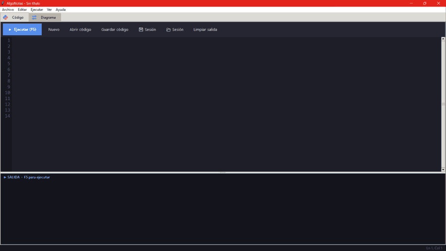
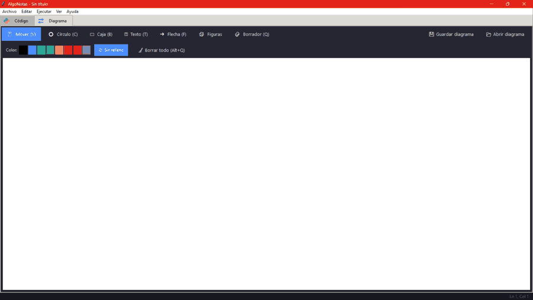

# ALGONOTAS V 1.0

Algonotas es un pequeño software pensado para la inmediatez de escribir códigos, diagramas de flujo o ejemplos para el dictado online de clases a niños y adolescentes.

Esta programado en python **3.11**, puede covertirse el ejecutable mediante **PyInstaller**:

```bash
# Instalar PyInstaller (una sola vez)
pip install pyinstaller

# Generar el ejecutable (queda en la carpeta dist/)
python -m PyInstaller --onefile --windowed --name AlgoNotas editor.py
```

## Requisitos

- Python 3.11 o superior
- Tkinter (viene incluido con Python)
- PyInstaller (`pip install pyinstaller`), solo para generar el ejecutable

## El programa

El programa se compone de un editor de código python con una consola de salida y una pestaña para la realización de diagramas de flujos con formas UML básicas.

### Editor de código

El editor de código posee un atajo a la impresión de conceptos básicos de programación mediante la sintáxis "?" + "palabra". Por ejemplo "?slice", el concepto se imprime en consola al apretar enter.

### Editor de diagramas

El editor de  diagramas se compone de formas básicas del sistema UML **2.5** cómo ser: círculo, caja, texto, flecha, rombo (decisión), persona, computadora, base de datos, monitor, servidor, nube y documento.

## Ejemplos de uso

**Editor de código**



**Editor de diagramas**



**Todo junto (ambas pestañas)**


## Atajos

- **F5**: ejecutar el código.
- **V / C / B / T / F / Q**: mover, círculo, caja, texto, flecha, borrador (en la pestaña Diagrama).
- **Alt + Q**: borrar todo el diagrama.
- **Ctrl + rueda**: zoom · **Ctrl + N / O / S**: nuevo, abrir, guardar.

## Guardado

Se puede guardar tanto el código mediante extensión .py y el diagrama en json. También se puede guardar la sesión mediante extensión ".aga".

---

⭐ Si te gustó, ponele una estrella.

🌐 Mi página web: [alvaroreta.com](https://alvaroreta.com)
